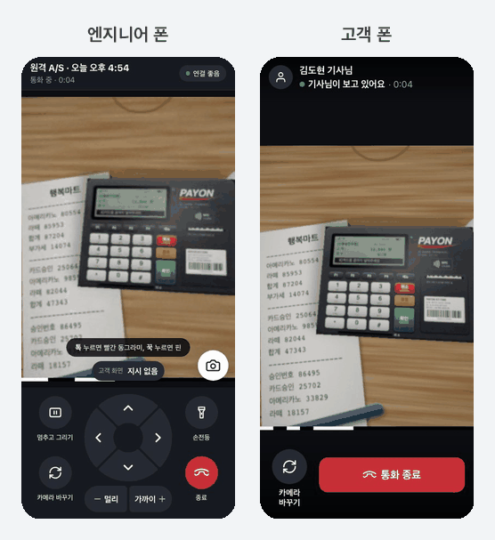
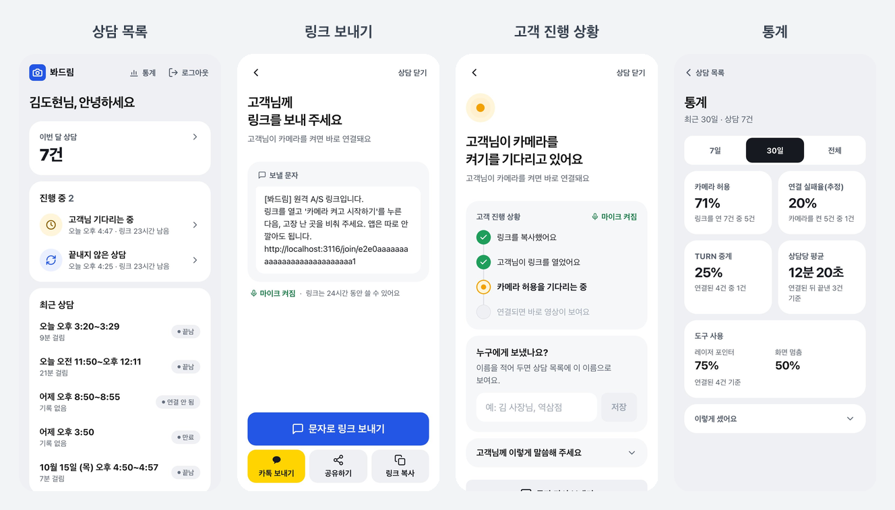
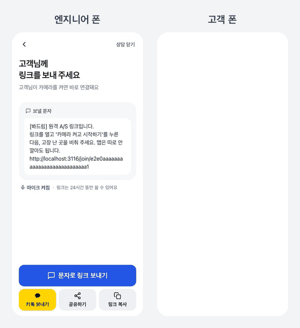
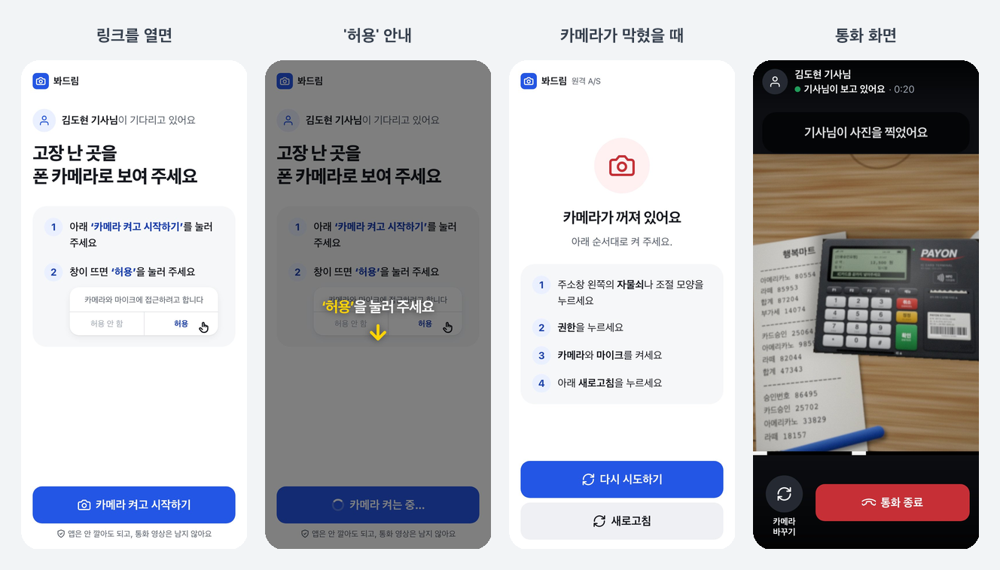
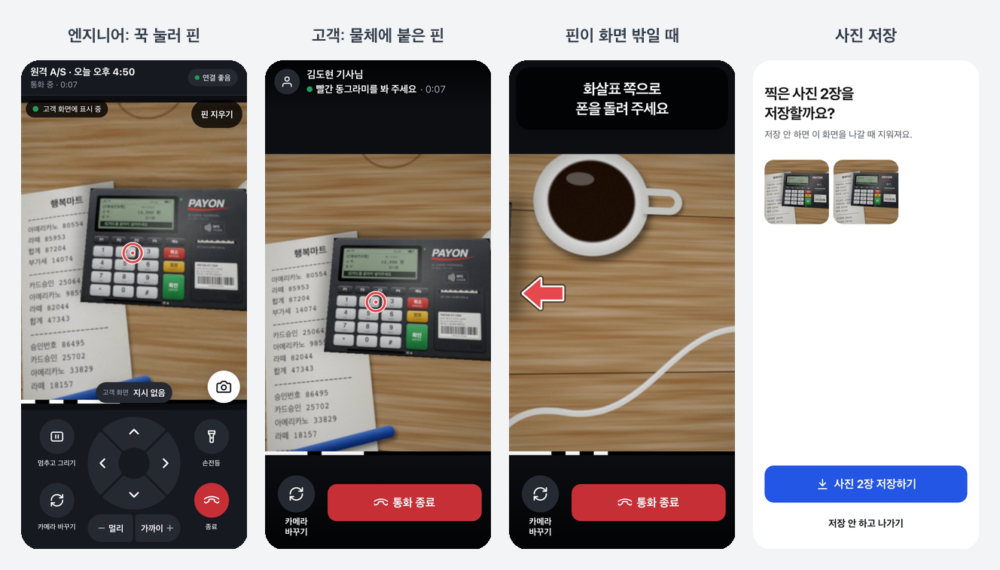
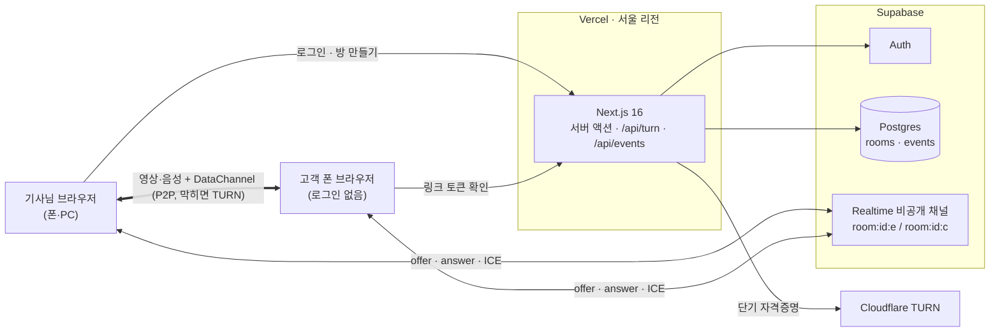

<div align="center">

# 봐드림

**문자로 받은 링크를 누르면 고객 폰 카메라가 기사님 화면에 뜨는 원격 A/S 웹 서비스**

고객은 앱 설치도, 회원가입도 하지 않습니다. 링크를 열고 버튼 하나, '허용' 한 번이면 끝입니다.<br>
기사님은 그 영상 위를 톡 눌러 "여기요" 하고 가리키고, 방향을 알려 주고, 화면을 멈춰 동그라미를 그립니다.




<sub>왼쪽이 기사님 폰, 오른쪽이 고객 폰입니다. 톡 → 레이저 포인터, 방향 링을 누르는 동안 → 노란 화살표, 멈추고 그리기 → 고객 화면에도 같은 선</sub>

</div>

<br>

## 왜 만들었나

아버지가 카드단말기 대여 사업을 하십니다. 영수증 용지가 안 나온다, 화면에 이상한 글자가 떴다 같은 별일 아닌 문제에도 직접 찾아가는 일이 잦았습니다. 전화로 "왼쪽 아래 버튼이요" 해도 잘 통하지 않고, 팀뷰어 같은 설치형 도구는 가게 사장님들께 너무 어렵습니다.

**사장님이 폰 카메라로 단말기를 비추기만 하면** 기사님이 보면서 짚어 줄 수 있게 만들었습니다. 그래서 고객 쪽 원칙은 하나입니다. 링크 클릭 → 버튼 한 번 → 카메라. 탭 두 번을 넘기지 않습니다.

## 어떻게 쓰나

### 1. 기사님: 새 A/S를 만들고 링크를 보냅니다

문자 앱, 카카오톡, 공유하기, 링크 복사 중 그 기기에서 되는 것만 보여 줍니다. 문자는 기사님 번호로 가니 스팸처럼 보이지 않고, 문자 API 비용도 들지 않습니다. 고객이 링크를 열었는지, 카메라를 허용했는지 실시간으로 보입니다.



### 2. 고객: 링크를 열고 버튼 하나

30~60대 가게 사장님 기준으로 짰습니다. 큰 글씨와 큰 버튼, 한 화면에 한 가지 행동만 둡니다. 권한 창이 뜨는 자리(안드로이드는 아래, 아이폰은 가운데)를 화살표로 가리키고, 카메라를 막았을 때는 폰 종류와 원인에 맞춰 다시 켜는 방법을 안내합니다. 카카오톡 앱 안에서 열면 카메라가 안 되므로 인터넷 앱으로 넘깁니다.

<div align="center">

</div>



### 3. 통화 중: 짚고, 방향을 알려 주고, 붙여 두고, 찍습니다

| 도구 | 하는 일 |
|---|---|
| 레이저 포인터 | 영상을 톡 누르면 고객 화면 같은 자리에 빨간 동그라미 |
| 방향 지시 | 방향 링을 누르고 있는 동안만 고객 화면에 노란 화살표와 "오른쪽으로". 떼면 사라짐 |
| 멈추고 그리기 | 화면을 멈추고 손가락으로 그린 선이 고객 화면에도 그대로 |
| AR 핀 | 꾹 누르면 핀이 **물체에 붙습니다**. 고객이 폰을 움직여도 그 버튼 위에 남고, 화면 밖으로 나가면 화살표로 안내 |
| 사진 찍기 | 고객 폰 카메라 원본 해상도로 찍어 받음. 서버에 올리지 않고 통화가 끝나면 저장할지 물음 |
| 원격 카메라 | 고객 폰의 앞·뒤 카메라 전환, 손전등 켜기를 기사님이 대신 |



기사님은 폰에서 한 손으로도, PC에서 키보드·마우스로도 쓸 수 있고 통화 중에 기기를 바꿔 이어받을 수 있습니다.

## 기술적으로 고민한 것

### 관리형 SDK 없이 브라우저 WebRTC로 직접

1:1 통화만 하니 SFU가 필요 없다고 봤습니다. P2P로 가면 통화 한 건의 원가가 거의 0이라 "상담 건당 과금" 모델의 근거가 되고, 연결 지표를 직접 모을 수 있습니다. 대신 "항상 연결된다"를 직접 책임져야 해서 이렇게 했습니다.

- ICE 서버에 **Cloudflare TURN을 항상 포함**합니다. 자격증명은 서버(`/api/turn`)가 고객 링크 토큰을 확인한 뒤 단기로만 발급합니다
- 연결되면 `getStats()`로 실제 relay를 탔는지 확인해 `relay_used` 이벤트로 남깁니다. TURN 원가를 계산하는 근거입니다
- 미디어 로직은 `src/lib/webrtc` 안에만 둡니다. 필드에서 연결 실패율이 5%를 넘으면 LiveKit으로 바꿀 수 있게 UI와 분리했습니다

### 시그널링: 엔지니어 사칭 막기

Supabase Realtime **비공개** 채널을 역할별 일방통행 두 개로 나눴습니다. `room:{id}:e`(엔지니어 → 고객)는 Postgres RLS 정책으로 방 주인만 보낼 수 있고, 고객은 이 채널에서 온 신호만 믿습니다. 링크를 손에 넣은 다른 사람이 기사님인 척 offer를 보낼 수 없습니다.

### DataChannel을 용도별로 나눈 이유

처음엔 포인터·그리기·방향 지시를 한 채널(`draw`)에 실었습니다. 그랬더니 멈춘 화면 조각(이미지)이 전송되는 동안 방향 지시 메시지가 뒤에 막혀, 고객 화면의 화살표가 1.5초 타임아웃으로 사라지는 문제가 생겼습니다. 순서 보장 채널의 head-of-line blocking입니다. 지금은 `draw` / `guide` / `photo` / `anchor`를 따로 엽니다.

### AR 핀: 외부 CV 라이브러리 없이 평면 추적

A/S 대상(단말기, 공유기 뒷면, 보일러 컨트롤러, 두꺼비집)은 대부분 평면이라 SLAM 대신 **즉석 평면 타깃 추적**을 TypeScript로 직접 구현했습니다.

- 기준 프레임에서 FAST 코너 + ORB 디스크립터 → 현재 프레임과 해밍 매칭 → RANSAC 호모그래피
- 추적은 피라미드 Lucas-Kanade(순방향·역방향 검사), 기준 프레임과 주기적으로 다시 맞춰 드리프트를 억제
- 엔지니어와 고객이 **각자 자기 영상에서** 같은 기준을 추적하므로 네트워크 지연이나 시계 동기화가 필요 없음
- 확신이 없으면 숨깁니다. 옆 버튼을 가리키는 것이 안 보이는 것보다 훨씬 나쁘기 때문입니다
- Web Worker에서 돌고, Node 벤치마크(`npm run bench:tracking`)와 같은 코드를 씁니다. 설계는 [src/lib/tracking/README.md](src/lib/tracking/README.md)

### 테스트와 화면 카탈로그

- 단위 테스트 501개(Vitest), e2e 40여 개(Playwright). e2e는 **가짜 카메라 영상 + 가짜 Supabase + 실제 WebRTC 루프백**으로 두 브라우저를 진짜로 연결합니다
- `npm run screens` 한 번이면 오류·대기·끊김까지 **화면 상태 100여 개**를 폰·PC로 찍어 HTML 한 장에 모읍니다. 위 이미지와 움짤도 이 장치로 만들었습니다(`npm run readme:media`)

### 요구사항 문서로 소통

기능 요구사항 110여 개를 [docs/requirements.md](docs/requirements.md)에 ID(`CALL-15` 같은)와 상태(✅/🚧), 확인 방법, 관련 코드로 정리합니다. 기능을 바꾸면 같은 커밋에서 문서를 고칩니다. 코드를 보지 않는 사람과도 ID로 이야기할 수 있게 하려는 것입니다. 알려진 문제(BUG-01~33)도 같은 문서에서 원인과 해결을 기록합니다.

## 구조



```
src/lib/webrtc/     통화 연결, ICE, 시그널링, 포인터·그리기·방향·사진 DataChannel
src/lib/tracking/   AR 핀 평면 추적 (ORB · LK · RANSAC, Web Worker)
src/app/(engineer)/ 로그인, 상담 목록, 통화, 통계 (로그인 필요)
src/app/join/       고객 진입 (공개, 32자리 링크 토큰)
src/components/ui/  디자인 시스템 부품 (피그마 컴포넌트와 같은 이름)
e2e/                Playwright e2e, 화면 카탈로그, README 움짤 녹화
```

## 지표

어떤 기능이 실제로 쓰이는지 보려고 `room_created`, `link_opened`, `camera_granted`, `connected`, `relay_used`, `pointer_used`, `guide_used` 같은 이벤트를 남기고 통계 화면에서 봅니다.

1. 링크를 연 고객 중 카메라를 허용한 비율
2. 연결 실패율, TURN 사용 비율 (원가 근거)
3. 고객과 연결됐던 상담의 평균 시간

## 로컬 실행

```bash
cp .env.example .env.local   # Supabase, Cloudflare TURN 값 채우기
npm install
npm run dev
```

Supabase SQL Editor에서 `supabase/schema.sql`을 실행합니다. 카메라는 HTTPS에서만 동작하므로 폰으로 볼 때는 `npx ngrok http 3000`이나 Vercel Preview를 씁니다.

```bash
npm test               # 단위 테스트
npm run e2e            # 두 브라우저를 실제로 연결하는 e2e
npm run screens        # 모든 화면 상태 → screens/index.html
npm run readme:media   # README 움짤 녹화 → scripts/readme-media 로 합치기
```

<details>
<summary><b>브라우저 제약, 범위, 시장 참고</b></summary>

### 브라우저 제약

- 카메라·마이크는 사용자가 버튼을 누른 뒤에만 요청 (iOS 정책)
- 카카오톡 앱 안 브라우저: iOS는 카메라 불가, 안드로이드는 불안정 → 감지해서 인터넷 앱으로 넘김. 문자로 보내면 이 문제가 없음
- 브라우저는 다른 앱 위에 그리거나 입력을 넣을 수 없음 → 원격 제어는 설치형에서만

### 1차 범위에서 뺀 것

- 고객 PC 화면 공유 (`getDisplayMedia`로 가능, 2차)
- 상담 건당 과금 (Viewabo 방식: 좌석 무제한, 월 N건)
- 설치형(WPF + WebView2): 화면 위 오버레이와 원격 제어, 유료 등급

### 시장 참고

- 리모트콜 비주얼팩(알서포트): 같은 기능, 대기업 콜센터 대상, 상담원당 라이선스
- 버넥트 리모트: 산업용 AR, 계정당 월 3만 원
- Viewabo(해외): 문자 링크, 앱 없음, 월 $79에 50건. 우리와 가장 가까움
- 삼성전자서비스: 원격 상담 고객 10명 중 6명이 출장 없이 해결

</details>

---

© 2026 이선용. 포트폴리오로 공개한 저장소예요. 코드를 가져다 쓰거나 서비스에 쓰려면 먼저 연락 주세요.
